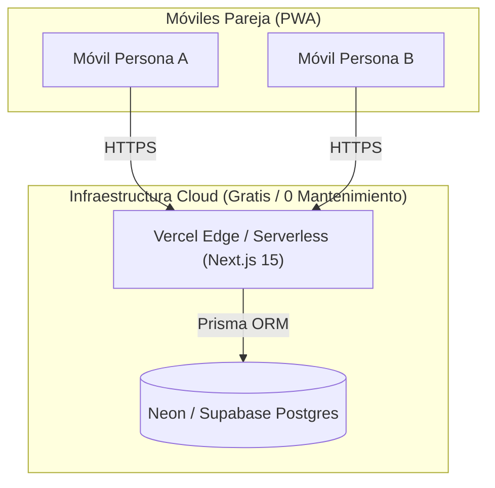

# Software Design Document (SDD)
## Sistema de Finanzas Hogareñas en Pareja (Fondo Común Proporcional)

**Versión:** 1.0  
**Fecha:** Octubre 2026  
**Estado:** Propuesta de Arquitectura y Especificación  

---

### 1. Resumen Ejecutivo y Diagnóstico: ¿Cómo vemos partir de Spliit?

#### 1.1. Diagnóstico de Spliit (`spliit-app/spliit`)
Spliit es una excelente aplicación open-source construida con **Next.js (App Router), TypeScript, Tailwind CSS, Prisma ORM y PostgreSQL**. Su UX mobile-first y su simplicidad para registrar gastos son puntos muy fuertes.

Sin embargo, existe una **diferencia conceptual clave**:
- **Spliit está orientado a deudas transaccionales (Debt-settling)**: Modela eventos como viajes o cenas donde una persona paga y los demás le deben según una división fija (50/50, partes o porcentajes por gasto).
- **Tu necesidad es de Fondo Común con Aportes Proporcionales (Budgeting & Income Pooling)**: Modela un ciclo mensual continuo donde los miembros comprometen un porcentaje de su ingreso (ej. 60%) para solventar el estilo de vida común, deduciendo de esa obligación los gastos realizados de bolsillo o monitoreando el consumo de una billetera común.

#### 1.2. Veredicto Técnico
> [!TIP]
> **Recomendación: Arquitectura inspirada en Spliit o Fork Adaptativo.**  
> Aprovechar los componentes UI (diseño mobile-friendly, selectores de categorías, carga rápida de tickets, estética limpia) pero **extender el modelo de datos** para introducir las entidades `MonthlyPeriod`, `Income/Contribution` y un motor de liquidación mensual (`PoolEngine`).

---

### 2. Lógica de Negocio y Modelo Matemático del Fondo Común

Existen dos dimensiones en el ciclo mensual:

#### 2.1. Ciclo de Gastos y Compensación (Durante el mes)
1. **Declaración mensual**: 
   - Persona A gana $S_A$, su aporte comprometido es $C_A = S_A \times 0.60$.
   - Persona B gana $S_B$, su aporte comprometido es $C_B = S_B \times 0.60$.
   - Capacidad total del fondo mensual: $F = C_A + C_B$.
2. **Registro de gastos**:
   - Cada uno paga gastos del hogar con sus propias tarjetas o efectivo (o fondo común).
   - Persona A pagó en total $G_A$.
   - Persona B pagó en total $G_B$.
   - Gasto total del hogar: $G_T = G_A + G_B$.
3. **Cierre de ciclo (Compensación de bolsillo)**:
   - Cuánto desembolsó cada uno respecto a lo que le tocaba aportar:
     $$\text{Balance}_A = G_A - C_A \qquad \text{Balance}_B = G_B - C_B$$
   - Quien gastó menos de su aporte le compensa al otro la diferencia, o ambos completan la diferencia hacia el fondo.

#### 2.2. Módulo de Ahorro / Fondo Común de Inversión (FCI - Fin de mes)
- **Cálculo de Excedente / Remanente:**
  $$\text{Remanente} = F - G_T$$
- **Lógica de Inversión (FCI):**
  - Si $\text{Remanente} > 0$: El sobrante no se diluye ni se pierde; se destina automáticamente a la bolsa de **Fondo Común de Inversión (FCI)**.
  - La app lleva la trazabilidad de:
    - **Capital histórico invertido acumulado:** Suma de remanentes de todos los meses.
    - **Aporte proporcional al FCI:** Cada persona es dueña del FCI en la proporción acumulada de sus aportes del 60% que sobraron.
    - **Registro de rendimiento/tasa:** Permite ingresar el saldo actual del FCI (ej. en broker/banco) para ver rendimientos ganados en pareja.

---

### 3. Arquitectura del Sistema e Infraestructura Ultra-Sencilla

Para mantener la infraestructura con costo \$0, cero mantenimiento de servidores y alta disponibilidad para ambos:

- **Hosting & Backend:** **Vercel** (Next.js 15 App Router + React Server Actions). Despliegue continuo con cada commit a GitHub.
- **Base de Datos:** **PostgreSQL Serverless en Neon o Supabase** (free tier permanente, sin servidores que parchar ni configurar, backups automáticos). Compatible al 100% con SQLite en desarrollo local.
- **ORM:** **Prisma ORM** (tipado estricto, migraciones automáticas).
- **Frontend & UI:** Tailwind CSS, componentes inspirados en la UX táctil de Spliit (botones grandes, teclado numérico tipo calculadora, selector de pagador rápido).
- **Acceso Móvil (PWA):** Progressive Web App con icono en la pantalla de inicio de los teléfonos de ambos, sin pasar por App Store ni Google Play.



---

### 4. Modelo de Datos (Data Schema con Módulo FCI)

```prisma
datasource db {
  provider = "postgresql"
  url      = env("DATABASE_URL")
}

generator client {
  provider = "prisma-client-js"
}

model Household {
  id              String          @id @default(cuid())
  name            String          @default("Nuestro Hogar")
  currency        String          @default("ARS")
  defaultRate     Float           @default(0.60) // 60%
  createdAt       DateTime        @default(now())
  users           User[]
  periods         MonthlyPeriod[]
  categories      Category[]
  investments     InvestmentFund[]
}

model User {
  id            String       @id @default(cuid())
  email         String       @unique
  name          String
  householdId   String
  household     Household    @relation(fields: [householdId], references: [id])
  incomes       Income[]
  expensesPaid  Expense[]    @relation("ExpensePayer")
  createdAt     DateTime     @default(now())
}

model MonthlyPeriod {
  id            String       @id @default(cuid())
  year          Int
  month         Int          // 1 a 12
  status        PeriodStatus @default(OPEN) // OPEN, CLOSED
  householdId   String
  household     Household    @relation(fields: [householdId], references: [id])
  incomes       Income[]
  expenses      Expense[]
  settlement    Settlement?
  investmentTransfer InvestmentContribution?
  createdAt     DateTime     @default(now())

  @@unique([householdId, year, month])
}

enum PeriodStatus {
  OPEN
  CLOSED
}

model Income {
  id               String        @id @default(cuid())
  amount           Decimal       // Sueldo neto cobrado
  contributionPct  Float         @default(0.60) // 60%
  targetPoolAmount Decimal       // amount * contributionPct
  userId           String
  user             User          @relation(fields: [userId], references: [id])
  periodId         String
  period           MonthlyPeriod @relation(fields: [periodId], references: [id])
  createdAt        DateTime      @default(now())

  @@unique([userId, periodId])
}

model Category {
  id          String    @id @default(cuid())
  name        String    // Supermercado, Alquiler, Salidas, Servicios, etc.
  icon        String?   // Lucide icon
  color       String?
  householdId String
  household   Household @relation(fields: [householdId], references: [id])
  expenses    Expense[]
}

model Expense {
  id            String        @id @default(cuid())
  title         String
  amount        Decimal
  date          DateTime      @default(now())
  paidById      String
  paidBy        User          @relation("ExpensePayer", fields: [paidById], references: [id])
  isFromPoolFund Boolean      @default(false)
  categoryId    String
  category      Category      @relation(fields: [categoryId], references: [id])
  periodId      String
  period        MonthlyPeriod @relation(fields: [periodId], references: [id])
  notes         String?
  createdAt     DateTime      @default(now())
}

model Settlement {
  id             String        @id @default(cuid())
  periodId       String        @unique
  period         MonthlyPeriod @relation(fields: [periodId], references: [id])
  totalPool      Decimal       // Aportes totales 60%
  totalSpent     Decimal       // Gastos totales
  surplus        Decimal       // Remanente (totalPool - totalSpent)
  netBalanceA    Decimal       // Balance de bolsillo persona A
  netBalanceB    Decimal       // Balance de bolsillo persona B
  transferAmount Decimal       // Monto de compensación entre ambos
  payerId        String?
  receiverId     String?
  settledAt      DateTime?
}

// Módulo de Fondo Común de Inversión (FCI)
model InvestmentFund {
  id             String                   @id @default(cuid())
  householdId    String
  household      Household                @relation(fields: [householdId], references: [id])
  name           String                   @default("FCI Ahorro Pareja")
  currentValue   Decimal                  @default(0) // Valor actualizado en el broker
  contributions  InvestmentContribution[]
  updatedAt      DateTime                 @updatedAt
}

model InvestmentContribution {
  id             String         @id @default(cuid())
  fundId         String
  fund           InvestmentFund @relation(fields: [fundId], references: [id])
  periodId       String         @unique
  period         MonthlyPeriod  @relation(fields: [periodId], references: [id])
  amount         Decimal        // Monto del remanente transferido al FCI
  userAQuota     Decimal        // Cuota atribuible a A
  userBQuota     Decimal        // Cuota atribuible a B
  investedAt     DateTime       @default(now())
}
```

---

### 5. Flujos de Usuario Principales

#### 5.1. Inicio de Mes (Declaración de Sueldos)
- Ambos ingresan su sueldo neto.
- La app fija el 60% de cada uno y define el **Fondo Común Disponible**.

#### 5.2. Durante el Mes (Carga Rápida estilo Spliit)
- Teclado numérico grande, categoría rápida, switch de quién pagó.
- Barra de progreso que muestra:
  - Presupuesto consumido.
  - **Remanente proyectado para FCI** en tiempo real.

#### 5.3. Fin de Mes (Cierre & Inversión)
1. **Liquidación:** Se nivelan los pagos de bolsillo entre ambos.
2. **Pase a Inversión:** Se aprueba el pase del remanente al **FCI de la pareja**.
3. **Métricas de Ahorro:** Gráfico de crecimiento del patrimonio invertido conjunto mes a mes.

---

### 6. Estrategia de Implementación

| Fase | Alcance | Hitos principales |
|---|---|---|
| **Fase 1: Base de Datos & Setup** | Estructura core y modelo Prisma | Configuración de Next.js 15, Prisma schema, auth simple de 2 personas por hogar. |
| **Fase 2: Motor de Fondo Común (`PoolEngine`)** | Lógica de cálculo de saldos y 60% | Algoritmo de liquidación, gestión de períodos mensuales, ingresos de cada miembro. |
| **Fase 3: UI Mobile-First inspirada en Spliit** | Vistas y componentes visuales | Carga ultra-rápida de gastos, Dashboard con barra de progreso del fondo, desglose por categorías. |
| **Fase 4: Módulo FCI & Ahorro Excedente** | Inversión del remanente | Traspaso al fondo de inversión, métricas de patrimonio conjunto y rendimientos. |
| **Fase 5: PWA & Optimización iPhone** | Instalación nativa en iPhone | Safe area insets (Dynamic Island / Home bar), teclado numérico ergonómico y touch gestures. |

---

### 7. Optimización de UX/UI para iPhone 15 Pro / 16 Pro (iOS Safari & PWA)

Para que la experiencia se sienta idéntica a una aplicación nativa de iOS en la pantalla del iPhone 15 Pro / 16 Pro:

#### 7.1. Viewport y Safe Area Insets (Dynamic Island & Home Indicator)
- **Configuración del Viewport:**
  ```html
  <meta name="viewport" content="width=device-width, initial-scale=1, viewport-fit=cover, maximum-scale=1, user-scalable=no" />
  ```
- **Soporte de Dynamic Island:**
  Padding superior dinámico usando `pt-[env(safe-area-inset-top)]` para que la barra de estado y la Dynamic Island no superpongan encabezados ni botones.
- **Soporte de Home Indicator (Barra inferior de iOS):**
  Espacio de seguridad inferior `pb-[env(safe-area-inset-bottom)]` en el menú de navegación inferior y botones fijos (*Sticky CTA*), asegurando que el gesto de deslizar para salir de iOS no interfiera con los toques de la app.

#### 7.2. Ergonomía del Pulgar (One-Handed Thumb Zone)
- La pantalla de 6.1" (iPhone 15/16 Pro) o 6.3" (iPhone 16 Pro) exige que las acciones frecuentes estén en el **tercio inferior de la pantalla**.
- **Bottom Navigation Bar fija** con 3 accesos: *Dashboard*, *+ Cargar Gasto (botón central destacado)* y *FCI / Ahorro*.
- **Quick Pad (Teclado numérico táctil propio):** Evita la lentitud de abrir y cerrar el teclado del sistema de iOS al cargar montos. Cuenta con botones de tamaño generoso (mínimo 56x56px) con respuesta táctil `active:scale-95`.

#### 7.3. Prevención de Bugs Clásicos de iOS Safari
1. **Evitar Zoom Indeseado:** Todos los campos de texto e inputs tendrán `font-size >= 16px` para que iOS Safari no aplique auto-zoom al hacer foco.
2. **Evitar Selección Accidental de Texto:** Clases `select-none` en tarjetas interactivas, botones y tags.
3. **Control de Rebote (Rubber-banding):** `overscroll-behavior-y: contain` para una sensación de contenedor nativo sólido.
4. **Modo Standalone (PWA):**
   - Icono `apple-touch-icon.png` de alta resolución (180x180 y 512x512).
   - Metatags de Apple Web App:
     ```html
     <meta name="apple-mobile-web-app-capable" content="yes" />
     <meta name="apple-mobile-web-app-status-bar-style" content="black-translucent" />
     <meta name="apple-mobile-web-app-title" content="Finanzas Hogar" />
     ```
   - Al agregarse a la pantalla de inicio ("Compartir -> Agregar a pantalla de inicio"), se ejecuta a pantalla completa sin barra de URL ni controles de Safari.
